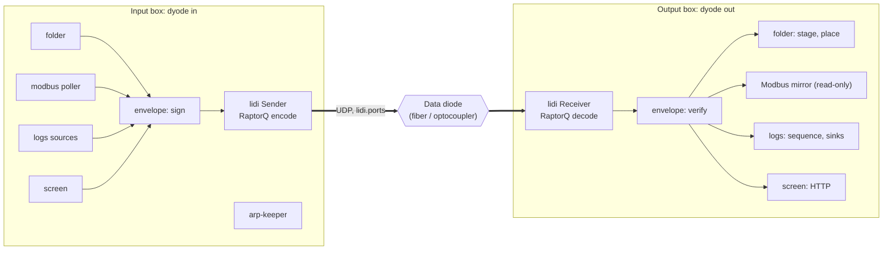

# Architecture

Two programs that never talk to each other directly.  The **input box** runs
`dyode in` and sends; the **output box** runs `dyode out` and receives.  Both
read the **same `config.yaml`**, so each side knows the other's addresses,
every module, and the lidi parameters that must match.



## lidi, embedded

lidi (ANSSI-FR, v3.0.0) is used as a library, not as separate daemons:

* `lidi_send::Sender` is created from a lidi configuration that DYODE
  generates from `config.yaml` (`dyode lidi-config` prints it).  DYODE hands
  it in-process `Read` sources with `Sender::new_client(endpoint, ..)`.
* `lidi_receive::Receiver` is given a DYODE `ClientLifecycle`: for each
  transfer lidi asks for an output, and DYODE gives it an in-process
  envelope parser for the module that endpoint belongs to.

lidi's TCP/TLS/Unix client sockets are therefore not used; the `unix:`
endpoint strings in the generated configuration are only labels.  What lidi
does is everything between the two boxes: splitting into blocks, RaptorQ
encoding with `repair`% extra packets, sending over `ports` (one thread
each), reordering, decoding, heartbeats, and multiplexing up to
`max_clients` transfers at once.

**Endpoints.**  A module's position in `config.yaml` is its endpoint id,
carried in lidi's Start block.  Both boxes read the same file, so the ids
agree.  The envelope also carries a tag derived from the module's name and
type, so a box with a different `config.yaml` is refused rather than
misrouted.

## One transfer per message

lidi delivers a byte stream reliably *or not at all*.  When a RaptorQ block
cannot be rebuilt, lidi aborts every transfer in progress, and the sender
cannot be told.  A long-lived stream through lidi would die silently at the
first lost block.  So DYODE never keeps one open: each Modbus poll, log
batch, screen frame, folder batch summary and file is a separate, short lidi
transfer.  A loss costs that transfer (and whatever else was in flight), and
the next one starts clean.

## The envelope

```text
header   "DYL1" | version 1 | kind (1 message, 2 file) | endpoint u16
         | module tag [8] | boot id [8] | counter u64
         | body length u64 | meta length u32 | meta (JSON)
body     body length bytes
trailer  SHA-256(body) [32] | HMAC-SHA256(key, header || SHA-256(body)) [32]
```

* A transfer is accepted only if the whole body and a valid trailer
  arrived.  Anything cut short by a lidi abort is reported
  (`file_rejected` with `reason: incomplete`, or a debug line for a lost
  Modbus poll, whose successor supersedes it).
* The HMAC covers the header (kind, endpoint, module, counter, length, and
  meta -- for a file, its path, size and mtime) and the body's SHA-256.
* The boot id is random per module per start; the counter rises with every
  envelope; the receiver refuses a (boot, counter) pair it has seen, or one
  more than 4096 behind (same rules as the Python version's DYA1 seal).
* Files are hashed as they are read, from the descriptor that was opened
  without following links, so what is signed is exactly what was sent.

## Modules

**folder.**  The input side scans `in` (links and `.dyode*` skipped), opens
each settled file with `openat(O_NOFOLLOW)` component by component, streams
it, then retires it to `.dyode_sent` (kept `keep_sent_hours`).  After each
batch it sends a signed summary (paths, sizes, SHA-256).  The output side
streams each file into the staging folder (`<out>.incoming`, never inside
`out`), and on a valid trailer renames it into `out` without following links
(`mkdirat`/`openat(O_NOFOLLOW)`/`renameat`).  The summary is matched
against what was stored; after `batch_timeout` of silence, missing files
are named (`file_missing`, `batch_received`).

**modbus.**  Input: a Modbus/TCP client (FC1, FC3) polls the ranges every
`interval` and sends one JSON message per poll.  Output: a read-only
Modbus/TCP server.  Writes get exception 01; with `unmapped: exception`
reads outside the ranges get 02.  Updates older than the last one applied
(lidi delivers concurrently) are skipped; `stale_after` warns when updates
stop.

**logs.**  Ported closely from the Python version: UDP/TCP syslog and
`tail -F` sources feed a bounded buffer.  Batches are compressed with zlib,
numbered, sent `copies` times, and capped by `max_kbps`; a heartbeat keeps
the sequence moving.  The output side reorders, de-duplicates, and reports
gaps and source drops, then writes to files (logrotate-aware) and/or
UDP/TCP forwarders.

**screen.**  The newest JPEG in `in`, at most `max_fps`; served as MJPEG
and `/screen.jpg`, at most `max_streams` viewers, on the IT-side address by
default.

## Processes

One process per box.  Every module runs in a supervised thread: a panic or
an error return is logged and the module restarted (5 s guard against crash
loops).  systemd restarts the process (`Restart=always`), stops it with the
diode NIC (`BindsTo=`) and starts it again when the NIC returns.

**ARP keeper (input box).**  Through a diode nothing can answer ARP, so the
output box's MAC is pinned as a permanent neighbour (`ip neigh replace ...
nud permanent`) at start-up -- DYODE refuses to start without it -- and
re-asserted every `arp_interval` seconds.

## DYODE v2 (serial)

lidi needs UDP, so the optocoupler variant keeps DYODE's line framing:
`<crc32 hex> <JSON>\n`, one thread owning the port, Modbus only.

## Code map

| File | Role |
|---|---|
| `src/main.rs` | the `dyode` command |
| `src/runtime.rs` | `in`/`out`/`serial-*`: start lidi and the modules |
| `src/transport.rs` | lidi configuration, `Uplink`/`ModuleLink`, receive `Lifecycle` |
| `src/envelope.rs` | the signed envelope: sources (send) and streaming parser (receive) |
| `src/auth.rs` | key file, HMAC-SHA256, replay window |
| `src/config.rs` | config.yaml loading and validation |
| `src/folder.rs`, `modbus.rs`, `logstream.rs`, `screen.rs`, `serial.rs` | the modules |
| `src/fsafe.rs` | link-safe file operations |
| `src/logging.rs` | human log, JSON events, logrotate-aware files |
| `src/supervisor.rs`, `watch.rs`, `netutil.rs`, `ratelimit.rs` | threads, inotify, ARP/NICs, pacing |
| `src/logs_tool.rs`, `setup.rs` | `dyode logs`, systemd units, firewall rules |
| `install.sh`, `packaging/` | installer, logrotate, archive timer |
